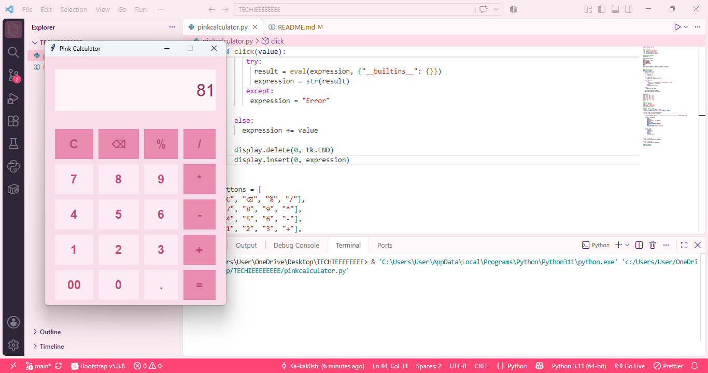

🎀 Pink Calculator
A desktop calculator application developed using Python and Tkinter, with a custom pink-themed graphical user interface.

🌸 About the Project
This project was built to practise Python programming and explore GUI development. It combines basic calculator functionality with a simple, interactive design.

✨ Key Features
Clean and interactive user interface
Custom pink-themed design
Basic arithmetic calculations
Functional on-screen buttons
💻 Built With
Python
Tkinter
⚙️ Getting Started
1. Clone the repository

git clone https://github.com/KaKaKoshi/pink-calculator.git
2. Navigate to the project folder

cd pink-calculator
3. Run the application

python pinkcalculator.py
📚 What I Learned
Building graphical user interfaces with Tkinter
Working with Python functions
Handling button events and user input
Organising application logic

👩‍💻 Author:
Developed as part of my journey in Python programming and software development.
